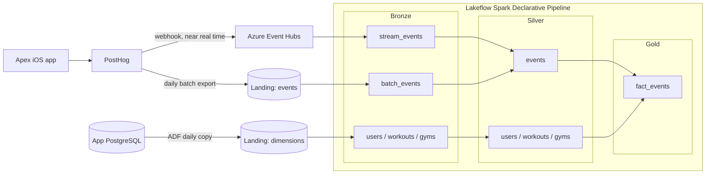

# Apex Data Pipeline

An end-to-end data engineering project built on real product analytics from **Apex**, a fitness app solo-developed by me live on the App Store. Events from the app are captured by PostHog, delivered to Azure in two ways (a near real-time stream and a daily batch export), combined with reference data from the app's PostgreSQL database, and modelled into a star schema with a Lakeflow Spark Declarative Pipeline on Databricks.

The project covers streaming and batch ingestion, data migration via Azure Data Factory, deduplication across sources, data quality expectations, PII handling at every layer, and dimensional modelling, all on data from real users rather than a sample dataset.

---

## Architecture



| Layer | Purpose | Dataset types |
|---|---|---|
| **Landing** | Files as delivered by PostHog (Stream and Incremental Batch) and Azure Data Factory (Batch) | Parquet in ADLS Gen2 |
| **Bronze** | Raw data as received, with personal data removed on the way in | Streaming tables (events), materialized views (dimensions) |
| **Silver** | Clean, typed, conformed and deduplicated | Streaming table with AUTO CDC (events), materialized views (dimensions) |
| **Gold** | Star schema for analysis | Materialized view (fact table) |

Each layer is a Unity Catalog schema (`apex.bronze`, `apex.silver`, `apex.gold`) whose managed location is its own container in the storage account, so every table is stored as Delta in storage.

---

## Tech stack

- **Event collection:** PostHog (React Native SDK)
- **Streaming ingestion:** PostHog webhook destination → Azure Event Hubs (read through its Kafka-compatible endpoint)
- **Batch ingestion:** PostHog batch export to Azure Blob Storage; Azure Data Factory for the PostgreSQL copy
- **Storage:** Azure Data Lake Storage Gen2
- **Processing:** Databricks Lakeflow Spark Declarative Pipelines (PySpark), serverless, triggered mode
- **Governance:** Unity Catalog, with an Azure managed identity (Access Connector) for storage access and a Databricks secret for the Event Hubs credentials
- **Deployment definition:** Databricks Asset Bundle

---

## Data sources

### 1. Event stream (PostHog → Event Hubs)

A PostHog webhook destination posts each event to the Event Hubs REST API, authenticated with a SAS token from a **Send-only** access policy. The webhook body is a custom flat JSON template rather than PostHog's default payload, which:

- **removes PII at the source:** email, name, username, IP address, postal code and coordinates are never sent;
- **flattens and renames fields**, so `$session_id` becomes `session_id` and `nudgeType` becomes `nudge_type`;
- **coarsens location** to city, region and country.

A destination filter keeps PostHog system events and authentication plumbing out of the stream:

```sql
event NOT IN (
  '$set', '$identify',
  'signin_stale_token_found', 'signin_stale_token_deleted', 'supabase_token_retry'
)
```

### 2. Event batch export (PostHog → Blob Storage)

PostHog's batch export writes Parquet files to the landing container, partitioned by date. It provided the historical backfill via a single batch export of 17K+ records and continues daily, acting as the system of record for events and as a safety net for anything the stream misses.

### 3. App database (PostgreSQL → ADF → Blob Storage)

An Azure Data Factory pipeline copies three tables daily: **users**, **workouts** and **gyms**. User data is read from a masked view, so only hashed emails, the email domains and masked names leave the database. Each run fully overwrites one fixed-name Parquet file per table.

---

## Pipeline

### Bronze

| Table | Type | Source | Notes |
|---|---|---|---|
| `apex.bronze.stream_events` | Streaming table | Event Hubs (Kafka endpoint) | Raw JSON body plus partition, offset and enqueued time; nothing parsed |
| `apex.bronze.batch_events` | Streaming table | Landing files via Auto Loader | `person_properties` dropped; IP, coordinates, postal code and `$set`/`$set_once` removed from the `properties` map |
| `apex.bronze.users`, `workouts`, `gyms` | Materialized views | Landing dimension files | Plain batch read, so each ADF overwrite is picked up |

Every bronze table records where and when each row was loaded (`_source_file`, `_ingested_at` as the file's modification time).

### Silver

**`apex.silver.events`**: one row per event from both sources.

1. **Conform:** two temporary views map the stream's flat JSON and the batch's `properties` map into one schema, driven by a single mapping dictionary.
2. **Type:** every field is read as a string, then cast once after the union with `try_cast`, so a bad value becomes null instead of failing the run.
3. **Scope and quality:** the same exclusion list is applied to both sources, and expectations drop rows without a `uuid` or event time and flag event times in the future.
4. **Deduplicate:** an AUTO CDC flow (SCD type 1) keyed on `uuid` keeps one row per event. When an event exists in both sources, the batch copy wins.

**`apex.silver.users`, `workouts`, `gyms`**

- **users:** renamed to `user_id`, which matches `distinct_id` in the events; the email domain is normalized.
- **workouts:** Postgres array literals in `muscle_groups` are parsed into `array<string>`, `Day N` labels become a numeric `day_number`, and a normalized `workout_name_key` is added for matching events. Free-text notes are dropped.
- **gyms:** unpivoted from one row per user (primary and secondary gym columns) to one row per user per slot, the grain the events use. Exact addresses and coordinates are dropped.

### Gold

**`apex.gold.fact_events`**: one row per event, joined by natural keys to the silver dimensions.

| Fact column(s) | Dimension | Join |
|---|---|---|
| `user_id` | `apex.silver.users` | `user_id` |
| `workout_id` | `apex.silver.workouts` | `workout_id` |
| `user_id`, `gym_slot` | `apex.silver.gyms` | `(user_id, gym_slot)` |

A foreign key is filled only when the dimension row exists, so every non-null key is guaranteed to join, and a null means no match (for example an anonymous event or a check-in failure without a gym). The raw `distinct_id` is kept so anonymous events can still be analysed.

---

## Key design decisions

**Two ingestion paths for the same events.** The stream delivers events within minutes; the batch export is the final and authoritative version. Silver merges both, so the warehouse is both fresh and correct.

**The batch copy is authoritative.** About 30% of events present in both sources had different timestamps, usually by under a second in repeated groups and occasionally by many minutes. The pattern fits PostHog applying its clock-skew correction separately for the real-time stream vs for the stored events. `sequence_by` uses a struct of source priority then load time, so the batch copy always wins regardless of arrival order.

**Strings first, types once.** Both sources produce text, so the union lines up exactly and type handling lives in one place.

**Materialized views wherever inputs change.** The dimension files are overwritten each time the ADF Pipeline triggers, so the SDP Pipeline implements Materialized Views for the same to ensure coherence.

**PII removed as early as possible.** Personal data is stripped in the webhook template for the stream, in bronze for the batch export, and in the database view for users. Silver and gold never see raw emails, IP addresses or exact locations.

---

## Data quality

Expectations enforced in the pipeline:

| Dataset | Rule | Action |
|---|---|---|
| silver events | `uuid` present, event time present | Drop row |
| silver events | Event time no more than a day in the future | Flag |
| silver workouts | `workout_id` present | Fail update |
| silver workouts | `user_id` and `workout_name` present | Flag |
| silver gyms | `user_id` and `place_id` present | Drop row |
| gold fact_events | Identified events match a user | Flag |

Validation queries run after each change check, among other things, that silver has exactly one row per `uuid`, that events present in the batch export are stored as their batch copy, that dimension row counts match bronze, and that the fact table has exactly one row per silver event.

---

## Example questions the star schema answers

**Busiest gyms by check-ins**

```sql
SELECT g.place_name, count(*) AS total_check_ins, count(distinct e.user_id) AS total_users
FROM apex.gold.fact_events e
    JOIN apex.silver.gyms g ON e.user_id = g.user_id AND e.gym_slot = g.gym_slot
WHERE e.event_name = 'gym_check_in_completed'
GROUP BY g.place_name
ORDER BY total_check_ins DESC
```


**Daily active users**

```sql
SELECT event_date_utc, count(DISTINCT user_id) AS active_users
FROM apex.gold.fact_events
WHERE user_id IS NOT NULL
GROUP BY event_date_utc
ORDER BY event_date_utc;
```


**Muscle groups ranked based on popularity**

```sql
SELECT explode(w.muscle_groups), count(*) AS times_started
FROM apex.gold.fact_events f
JOIN apex.silver.workouts w ON f.workout_id = w.workout_id
WHERE f.event_name = 'workout_started'
GROUP BY explode(w.muscle_groups)
ORDER BY times_started DESC;
```


---

## Repository structure

```
apex-data-pipeline/
├── databricks.yml        # Asset Bundle: bundle name and target workspace
├── resources/
│   └── *.pipeline.yml    # Pipeline configuration (catalog, compute, source files)
└── transformations/      # Pipeline code: bronze, silver and gold datasets
```

---

## Running the project

### Prerequisites

- An Azure subscription with an ADLS Gen2 storage account, an Event Hubs namespace (Standard tier, for the Kafka endpoint) and an Azure Data Factory instance
- An Azure Databricks workspace (Premium) with Unity Catalog
- A PostHog project with realtime destinations and batch exports
- The Databricks CLI

### Setup outline

1. **Storage:** create the `landing` container and one container per layer.
2. **Databricks access:** create an Access Connector, grant it Storage Blob Data Reader on landing and Storage Blob Data Contributor on the layer containers, then register a storage credential and external locations in Unity Catalog.
3. **Catalog:** create the `apex` catalog and the `bronze`, `silver` and `gold` schemas, each with a managed location in its container.
4. **Event Hubs:** create a Send-only policy for PostHog and a Listen-only policy for Spark. Store the Listen connection string in a Databricks secret scope.
5. **PostHog:** configure the webhook destination (custom body template and filter) and the Azure Blob Storage batch export.
6. **ADF:** create the PostgreSQL and storage linked services, the copy pipeline for the three tables, and a daily schedule trigger.
7. **Pipeline:** update the storage paths, Event Hubs namespace and secret scope names in `transformations/`, update the host in `databricks.yml`, then deploy:

```bash
databricks bundle validate
databricks bundle deploy
databricks bundle run apex_ingestion
```

No secrets are stored in this repository. The Event Hubs credentials are read from a Databricks secret scope at runtime.

---

## Limitations and future work

- **Workout matching by name.** Events carry a workout name, not an ID. When a user has two workouts with the same name, the most recently updated one is chosen. Adding `workout_id` and `gym_id` to the app's events would make these joins exact.
- **No receive time for batch rows.** PostHog's export doesn't provide a reliable receive time, so `captured_at` is null for batch events.
